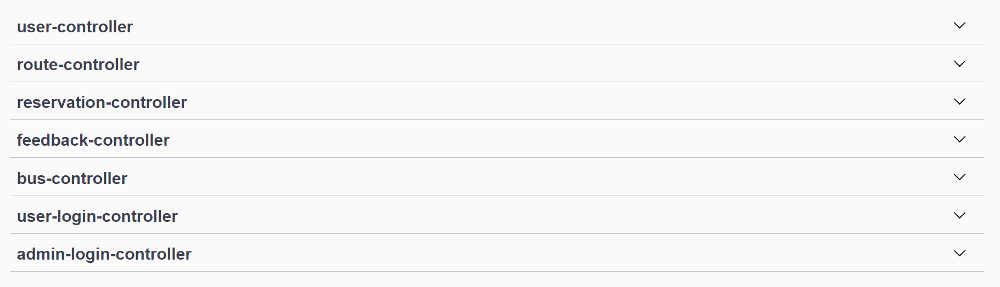
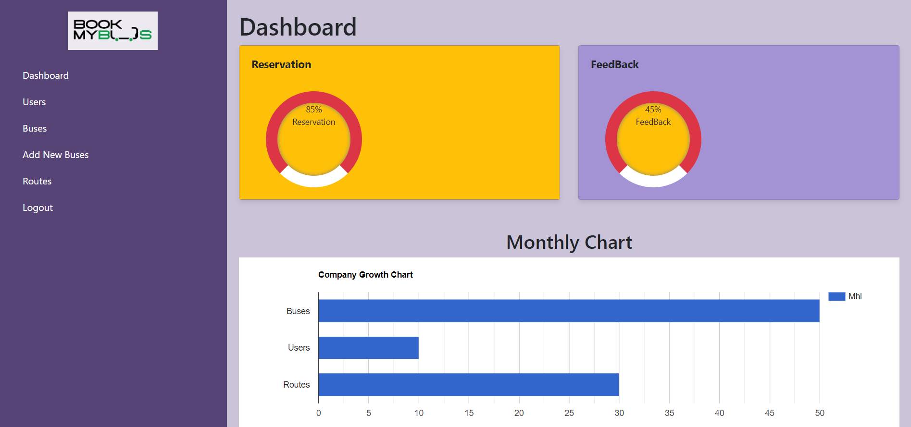
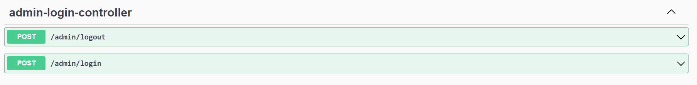
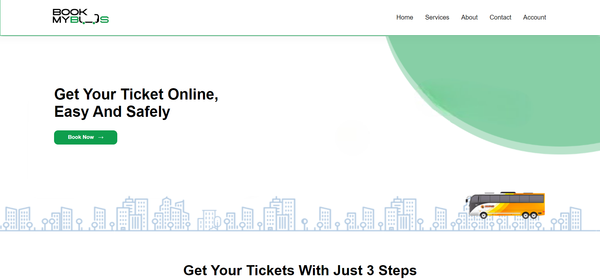
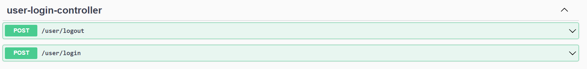
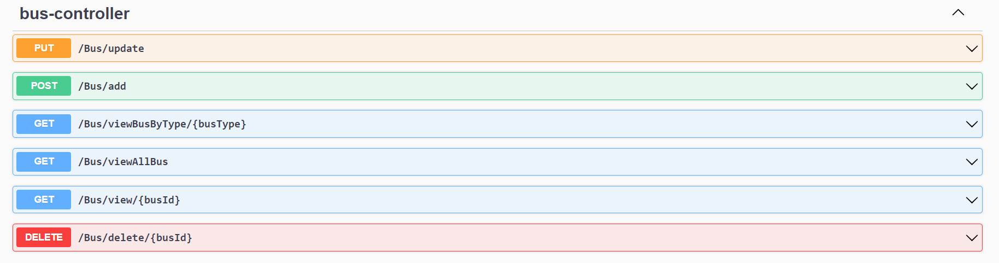
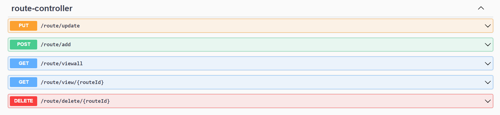
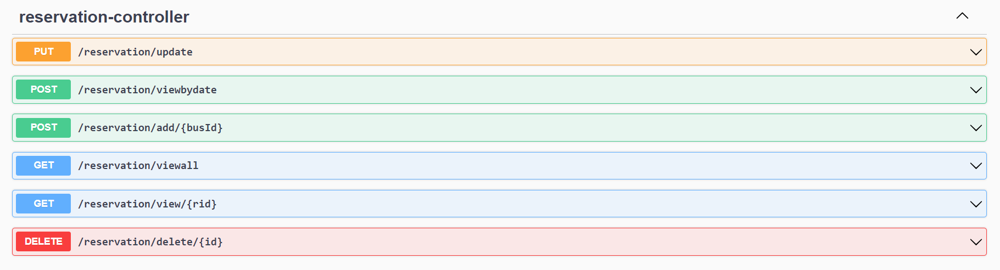
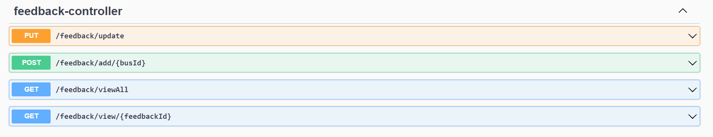

<p align="center">
  
</p>

# Book My Bus - Online Bus Ticket Reservation System

> Book my bus (bus ticket reservation system) is an RESTful web service designed to provide customers with a personalized easy-to-utilize user experience for booking and purchasing tickets online. It stores customers' personal data records, scheduled routes, frequent trips, drop points, and other information.

> It has 6 modules Admin, User, Reservation, Bus, Route and Feedback.


# Features

- User and Admin authentication and validation using session uuid
- Admin can provide details like Bus Name, Bus Route, Bus Type –AC/non-AC, seats, departure time and arrival time
- Admin can provide details of route
- Admin can provide the confirmation of the seat to the User
- User can register by giving all the details
- User can book ticket by selecting Source and destination
- User can give feedback for bus experience
- User can cancel reservation

# Technology used 

- Java
- Javascript
- Spring Boot
- Spring data JPA
- HTML
- CSS
- MySQL
- RESTful api
- Hibernate
- Swagger
- Lombok
- Maven
- Postman
- Spring tool suite eclipse
- Git & GitHub

# Setup Instructions

## 1. Database Setup (MySQL)
1. Ensure you have **MySQL** or **XAMPP** installed and running on your system.
2. Create a database named `masaidb` (or import using the provided SQL dump).
   ```sql
   CREATE DATABASE masaidb;
   ```
3. Import the provided `masaidb-utf8.sql` or `masaidb.sql` file into your local MySQL server.
4. Verify the database connection properties in the backend's `application.properties`:
   - URL: `jdbc:mysql://localhost:3306/masaidb`
   - Username: `root` (or your MySQL username)
   - Password: `<your_password>`

## 2. Backend Setup (Spring Boot)
1. Open the `BusTicketReservationSystem_Backend` folder.
2. Make sure you have **Java 17+** and **Maven** installed.
3. Open a terminal in the backend directory.
4. Run the following command to start the Spring Boot application:
   ```bash
   mvnw.cmd spring-boot:run
   ```
   *The backend will start running on `http://localhost:8088`.*

## 3. Frontend Setup
1. Open the `BusTicketReservationSystem_Frontend` folder.
2. Start a local HTTP server to serve the frontend files. If you have Python installed, you can use:
   ```bash
   python -m http.server 8080
   ```
3. Open your browser and navigate to `http://localhost:8080/index.html`.

# Current Implementation Updates
- **Admin Panel Enhancements:** Fixed inactivity crashes caused by Google Charts load issues and updated the UI to safely handle empty database tables without breaking Javascript.
- **Reservations Tracking:** Added a new `reservations.html` page to the Admin Panel for tracking user bookings directly.
- **Localization:** Updated the footer, `about.html`, and `contact.html` with new Coimbatore local contact details (e.g. `123 Cross Cut Road, Gandhipuram, Coimbatore`).
- **Session Handling:** Fixed bug with overlapping sessions on signup and admin login processes.

# Modules

- Login Logout Module
- Admin Module
- User Module
- Route Module
- Bus Module
- Reservation Module
- Feedback Module

# Lessons Learned

- Gain excessive knowledge on application of Java, MySQL and SpringBoot.
- Gain knowledge on creating RESTful API.
- Got to know how to collabrate with team members.
- Enjoyed the process of learning and creating the application.

# Overview of Our Work

## **ER Diagram** 
*Entity Relationship Diagram of the project*
</br>


## **All Modules & REST API Endpoints** 
*Swagger UI showing all controller endpoints*
</br>



## **Admin Home Page & Dashboard** 
*Admin can login using username (`admin`) and password (`admin1234`)*



## **Admin Login**


## **User Landing Page**


## **User Login & Registration**


## **Bus Controller API** 
*Admin can manage bus information, routes, seat capacity, and schedules*



## **Route Controller API**
*Admin can configure routes, origin, destination, and distances*



## **Reservation Controller API**
*Users can book reservations, view bookings, and manage tickets*



## **Feedback Controller API**
*Users can submit feedback and ratings for completed bus trips*


